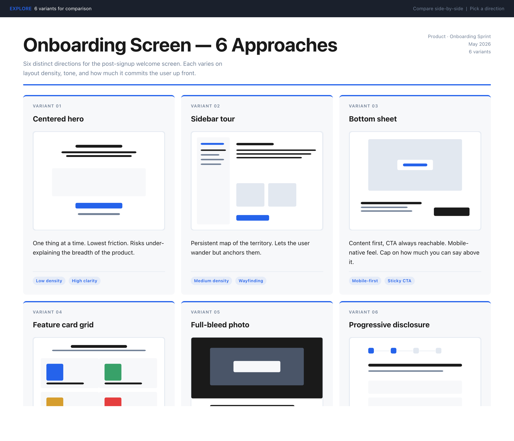
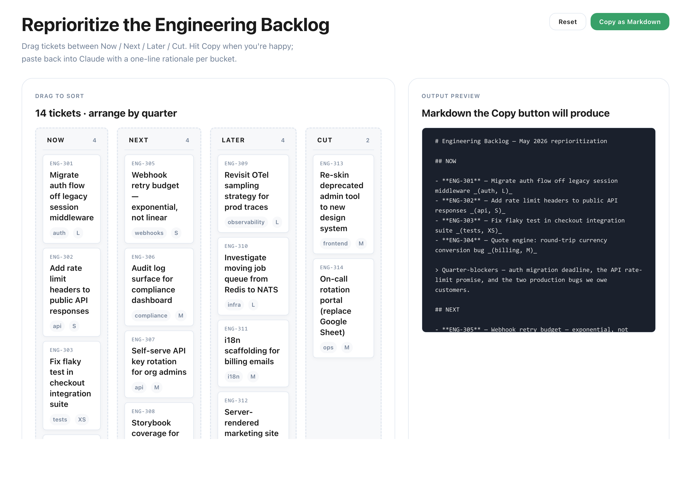
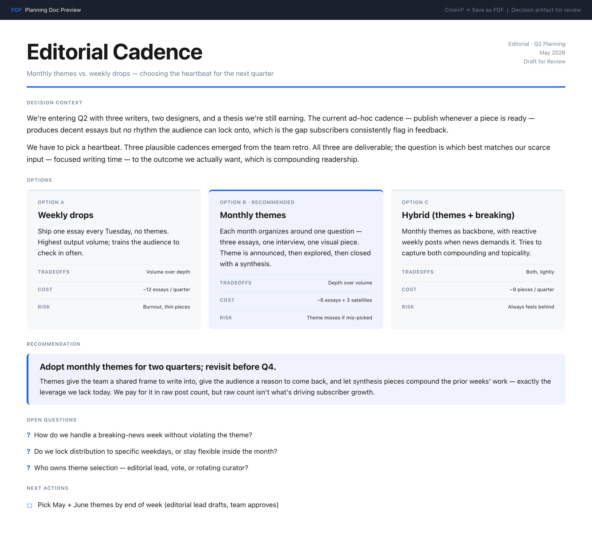
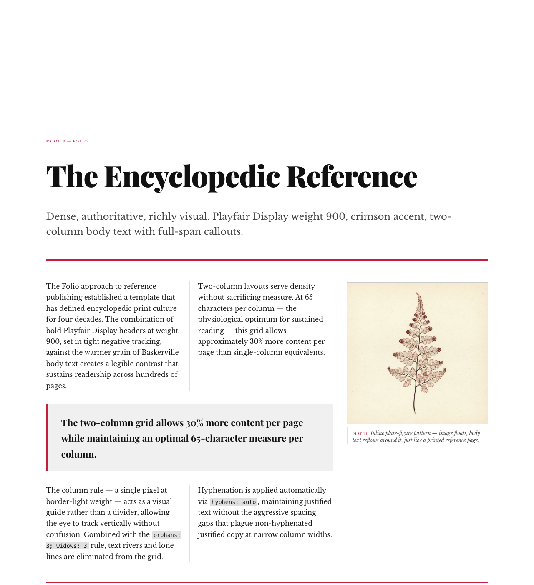
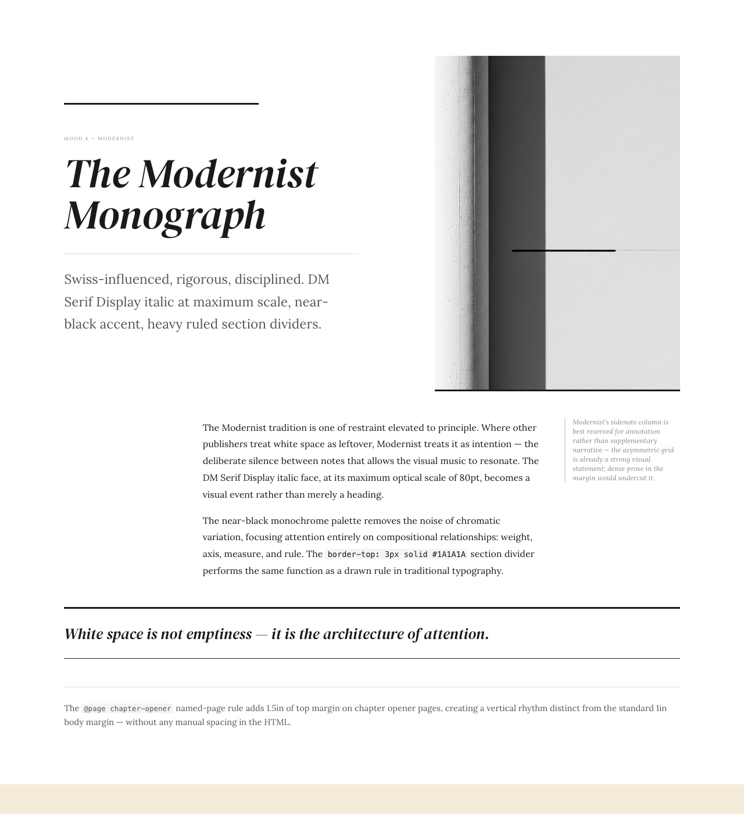
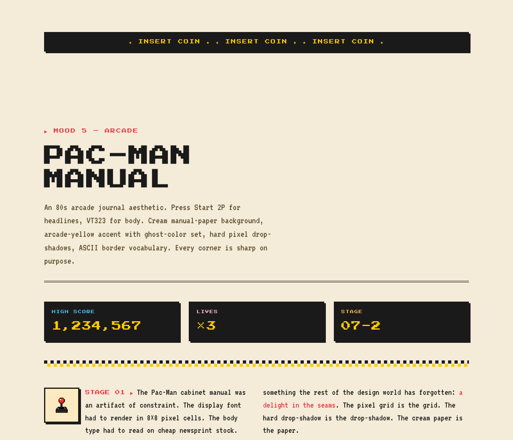
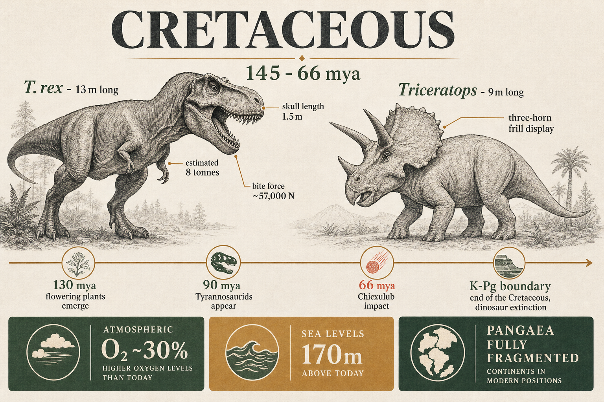

# ink

> Visualize just about anything in HTML

Agents end every task by handing you a wall of text. Ink turns research briefs, plans, workflow summaries, strategy memos — just about anything — into designed HTML instead, so the ideas actually land. It supplies a curated design system, so the output looks composed rather than generic.

Built for AI coding agents (Claude Code, Codex, and more).

## Install

```bash
npx skills add hurleywgly/skills --skill ink
```

Or add it for a specific agent, e.g. Claude Code:

```bash
npx skills add hurleywgly/skills --skill ink -a claude-code
```

Manual: copy this folder into your agent's skills directory (e.g. `~/.claude/skills/ink/` or `.agents/skills/ink/`).

## What it does

- **Visualize anything.** Digest research briefs, plans, workflow summaries, and strategy memos as designed HTML instead of a wall of text.
- **Doc zero to hero.** Take any doc, dataset, or pitch and transform all of it or just the highlights into a design as sharp as a coffee table book.

## Why it matters

Visuals make ideas land. HTML is malleable, shareable, and — no shame admitting it — a relief after the hundredth markdown doc an agent hands you.

## How it fits your workflow

Use ink to share ideas with others, or have your agents share theirs with you in visually rich HTML.

## Pairs well with

`pitch-me` • `research` • `design`

## Why HTML?

Markdown stops carrying you somewhere around 100 lines. Tables thin out. Diagrams become ASCII. Diffs become text. HTML keeps going — SVG diagrams, side-by-side grids, color-coded annotations, sliders that export back to a prompt, custom editors purpose-built for one piece of data. Ink gives that HTML a visual house so it doesn't look like generic AI output.

The skill won't lock you into rigid templates. You describe what you want; Ink picks a layout pattern, applies a mood, renders self-contained HTML. Open in a browser. PDF later, if you ever need it.

## Usage

```
"Explore six different directions for the onboarding screen.
 Vary layout, tone, density. Lay them out in a grid I can compare."

→ exploration grid, six labeled mockups with tradeoffs
→ ./output/onboarding-explorations.html → opens in browser
```

```
"Explain how prompt caching works. I want a research file with a
 diagram, code, the gotchas. Long form, monograph mood."

→ explainer with SVG flow diagram, drop cap, code block,
  pull quote, tradeoffs table, gotchas callout
→ ./output/prompt-caching-from-the-inside.html
```

```
"Build me a throwaway editor for reprioritizing these 14 backlog
 tickets across Now / Next / Later / Cut. Drag-and-drop with a
 'copy as markdown' button at the end."

→ kanban-style sorter with live preview, copy-to-clipboard
→ paste the result back into your agent
```

## What it can build

### Exploration · multiple approaches in a grid



For *"generate N distinct approaches to X — vary layout, tone, density — lay them out so I can compare."* Cards in a 3-column responsive grid, each with a label, an SVG sketch (or screenshot, or generated mockup), a one-line tradeoff caption, and tags that capture the dimensions you're varying on. A synthesis paragraph at the bottom names what's actually varying. Source: [`examples/type-exploration.html`](examples/type-exploration.html).

### Explainer · long-form research with diagrams


For *"explain how X works"* / *"in-depth research file"* / *"summarize this PR's behavior."* Drop cap on the lead, SVG flow diagrams (this one shows the prompt-caching hit/miss path), syntax-highlighted code blocks, pull quotes, a tradeoffs matrix, and a warning-bordered "gotchas" callout. Reads like a thoughtfully-set technical magazine article — not a wall of text. Source: [`examples/type-explainer.html`](examples/type-explainer.html).

### Editor · throwaway tools with copy-as-prompt



For when you'd rather drag than type. Single-file HTML tools purpose-built for one piece of data — drag/drop, sliders, dropdowns, whatever the data shape demands — paired with a live preview of what *Copy* will produce, and a button that drops the result on your clipboard so you can paste it back into your agent. The shown example is a Linear-style ticket reprioritizer. *Editor* is the one pattern where vanilla JS is allowed (the documented exception to Ink's no-JS rule). Source: [`examples/type-editor.html`](examples/type-editor.html).

### Planning · decision artifacts with options + recommendation



For *"draft a decision doc"* / *"options and recommendation"* / *"spec for the team to review."* Decision context up top, 2–4 option cards (recommended one highlighted with the accent border), a recommendation block with rationale, open questions, and a next-actions checklist. The shape that lets the next reader skim, decide, or push back. Source: [`examples/type-planning.html`](examples/type-planning.html).

### Plus the existing patterns

| Pattern | Best for |
|---|---|
| **Brief** | One-pagers, executive summaries, stakeholder updates |
| **Report** | PRDs, specs, analyses, multi-page deep dives |
| **Comparison** | Side-by-side matrices for variants, vendors, API surfaces |
| **Code review** | Diffs with margin annotations, severity color-coding, control-flow diagrams |
| **Presentation** | Slide-per-page HTML decks |
| **Infographic** | Stat-callout dashboards, metric cards, timelines |
| **Image** | Hero graphics, illustrations, banners (Gemini API, optional) |

## Mood gallery

Five curated typographic styles. Each is a distinct typographic voice — different fonts, palette, geometry, rhythm. Apply with one class on `<body>` (e.g. `class="mood-monograph"`).

### Crisp · system fonts, blue accent, business-ready


The default. System sans-serif, single blue accent, 20px-radius cards, no external dependencies. Use for executive briefs, exploration grids, planning docs, anything that should feel current and unfussy.

### Monograph · Cormorant Garamond, warm cream, photographic


Light on text, heavy on beauty. Cormorant Garamond display at weight 300, EB Garamond body, warm cream palette, generous negative space, full-bleed photography spreads. Use for portfolios, premium reports, explainers that should feel collectable.

### Folio · Playfair Display, crimson, two-column dense



Dense, authoritative, richly visual. Playfair Display weight 700, Libre Baskerville body, crimson accent, two-column body text with full-span callouts, plate-figure conventions. Use for reference docs, deep technical explainers, anything where authority matters.

### Modernist · DM Serif Display italic, monochrome, Swiss-rigorous



Swiss-influenced, rigorous, disciplined. DM Serif Display italic at maximum scale, Lora body, near-black accent, heavy ruled section dividers, asymmetric grids. Use for architectural / design / strategy docs, anything where restraint is the message.

### Arcade · Press Start 2P, pixel art, Pac-Man manual



Pac-Man manual / 80s game journal. Press Start 2P display, VT323 readable terminal body, cream manual-paper background, arcade-yellow accent with ghost-color set, hard pixel drop-shadows, ASCII border vocabulary. Use for retro/nostalgia content, gaming docs, internal playbooks with a wink.

## How it works

```
You: "Explain how X works. Long-form, with a diagram."

Ink picks: explainer pattern
     ↓
asks: which mood? imagery strategy?
     ↓
reads templates/base-styles.css (the design system)
     ↓
generates self-contained HTML with embedded CSS
     ↓
opens in browser → you read it
     ↓
optional: --print-to-pdf for sharing through Discord/email/etc.
     ↓
output saved to ./output/[slug].html
```

For images, Ink supports two provider backends (Google Gemini Nano Banana or OpenAI gpt-image-2 — both optional, both BYO key) and three image strategies — pick at the start, no surprises later.

## Image strategy

Every Ink doc asks once, up front:

| Strategy | What you get | Cost | Best for |
|---|---|---|---|
| `none` | Text + color blocks only. Lean on typography, accent color, CSS-drawn rules and halftones. | Free | Most exploration grids, planning docs, internal updates |
| `placeholders` | SVG data-URI placeholders sized to the layout — solid fills, halftones, simple shapes | Free | When a doc has hero/figure slots that would feel skeletal empty, but you don't need real photos |
| `generated` | Real generated imagery via Google Gemini Nano Banana **or** OpenAI gpt-image-2. | Gemini ~$0.04, OpenAI ~$0.006–$0.21 (low/medium/high) | Plate spreads, hero covers, infographics, when imagery carries weight |

**Hero vs. figure** — hero images express the brand (mixed-media collage, Saul-Bass-style); in-line figures communicate the argument (clean, legible, brings the reader along). Different prompts, different aesthetics. The skill knows.

### Provider notes

Both image providers are **optional and BYO key**. Configure either (or both):

```bash
# Google Gemini (Nano Banana) — free tier, ~$0.04/image
export GOOGLE_API_KEY="..."          # https://aistudio.google.com/apikey

# OpenAI gpt-image-2 — token-billed, ~$0.006 (low) / $0.05 (medium) / $0.21 (high) per image
export OPENAI_API_KEY="..."          # https://platform.openai.com/api-keys
```

Or store either/both in `~/.ink/config.json`:

```json
{ "google_api_key": "...", "openai_api_key": "..." }
```

If only one key is configured, Ink uses that provider automatically. If both are present, Ink asks which one to use — or you can name a provider in your request (`"...generate with gpt-image-2"` or `"...use Nano Banana"`). The provider abstraction is workspace-agnostic — both paths are documented in `SKILL.md` Step 5 with curl-level request shapes so any LLM driving this skill can call either endpoint.

**When to reach for which:**
- **Gemini Nano Banana** — fast, decent text rendering, good for illustrative/editorial heroes (monograph, folio plate spreads). Cheaper iteration.
- **OpenAI gpt-image-2** — sharper prompt adherence, **strong typography rendering inside the image** (labels, signs, callouts), more photoreal. Reach for it when an infographic needs legible embedded text, or when you want photoreal hero art with confident typography.

#### gpt-image-2 in practice — Cretaceous infographic, 1536×1024, `high` quality (~$0.21)



One-shot generation from the prompt *"Editorial infographic poster about the dinosaurs of the Cretaceous Period (145–66 mya). Hand-illustrated T. rex and Triceratops with anatomical callout lines and integrated typography labels. Horizontal timeline with 4 milestones. Three stat cards along the bottom. National Geographic / Pentagram museum-panel aesthetic, warm off-white background, ochre + forest green accents, single coral highlight..."*

Note the labels — `T. rex · 13 m long`, `skull length 1.5 m`, `bite force ~57,000 N`, the timeline milestones, the three stat cards along the bottom — every piece of embedded typography renders correctly and integrates with the illustration. This is the use case where gpt-image-2 earns its keep over text-light providers.

## What you get out of the box

- **Fluid typography** — `clamp()`-based scale (display / title-0..4 / headline / body / callout / subhead / caption / annotation), scales with viewport, floors at print-safe pt sizes
- **Editorial layout primitives** — drop caps (`initial-letter: 3` + `@supports` fallback), small caps, sidenotes, full-bleed images, two-column body, pull quotes, chapter openers via named `@page chapter-opener`
- **OpenType features on body text** — common ligatures, oldstyle numerals, hanging punctuation, kerning, hyphens, orphan/widow control
- **Print-aware** — `@page` rules with running page numbers, `:first` cover suppression, named pages for chapter openers, universal animation kill in `@media print`, proper page-break controls

## Contracts

Properties of Ink that are not negotiable per-doc:

1. **No JS dependencies for static patterns.** Reports, briefs, planning, exploration grids, comparisons, explainers, code reviews, presentations, and infographics output HTML + CSS + optional Google Fonts only. No animation libraries (GSAP, Anime.js, Motion One, Three.js). Motion is CSS-only (`@keyframes`, `view-timeline`, scroll-driven animations).
2. **The *editor* pattern is the exception.** Throwaway editor outputs may include vanilla JS (no frameworks) for controls, drag/drop, and copy-to-clipboard. They live and die in the browser; print isn't a concern for editors.
3. **Mood library is curated, not catalog.** General-purpose moods stay capped; new ones require a content category not served by the existing set, all selectors scoped under `.mood-<name>`, single CSS block, ≥1 live test doc. Project-derived moods (`mood-<project>`, sourced from a project's own `DESIGN.md`) sit alongside but don't count against the cap and live in their own project repo.
4. **HTML is the primary surface.** PDF is downstream — generate it when the user needs to share through an HTML-hostile channel, not by default.
5. **Outputs live outside the skill.** Generated artifacts go to `./output/` (cwd-relative — the directory you invoked Ink from), never inside the skill folder itself. Recipe ≠ meal.

## Design system at a glance

```css
:root {
  --ink-accent: #2563EB;       /* one variable re-themes everything */
  --brand-name: "Document";
  /* fluid type scale via clamp(), floors at print-safe pt sizes */
  --text-display: clamp(36pt, 7vw + 1rem, 72pt);
  --text-body:    clamp(10pt, 1.1vw + 0.2rem, 12pt);
  /* mood font pairs — switch via .mood-<name> on body */
  --font-display-monograph: 'Cormorant Garamond', Georgia, serif;
  --font-display-arcade:    'Press Start 2P', monospace;
  /* ... */
}
```

Apply a mood with one class:

```html
<body class="mood-monograph">  <!-- crisp / monograph / folio / modernist / arcade -->
```

## PDF (when you need it)

Ink's primary surface is HTML in a browser. If you need to share through Discord, email, Slack, or any other channel that doesn't render HTML inline, generate a PDF as a one-shot:

```bash
"/Applications/Google Chrome.app/Contents/MacOS/Google Chrome" \
  --headless --disable-gpu --no-pdf-header-footer \
  --print-to-pdf="./output/[slug].pdf" \
  "./output/[slug].html"
```

(On Linux, swap for `chromium --headless ...` or `google-chrome-stable --headless ...`.) Don't auto-PDF every doc — it's the exception, not the default.

## File structure

```
ink/
├── SKILL.md                          # Skill definition
├── README.md                         # You are here
├── templates/
│   ├── base-styles.css               # Ink design system (1500+ lines, all 5 moods)
│   ├── exploration-template.html     # 6-up grid for variant comparison
│   ├── explainer-template.html       # Long-form research with SVG diagram slots
│   ├── editor-template.html          # Throwaway tool: drag/drop + copy-as-markdown (JS allowed)
│   ├── planning-template.html        # Decision doc with options + recommendation
│   ├── report-template.html          # Multi-page report skeleton
│   ├── brief-template.html           # One-pager skeleton
│   ├── infographic-template.html     # Infographic skeleton
│   ├── presentation-template.html    # Slide deck skeleton
│   ├── monograph-template.html       # Monograph mood standalone
│   ├── folio-template.html           # Folio mood standalone
│   ├── modernist-template.html       # Modernist mood standalone
│   └── arcade-template.html          # Arcade mood standalone
└── examples/
    ├── redesign-showcase.html        # All 5 base moods in one doc — visual reference
    ├── type-exploration.html         # Realistic 6-up: onboarding screen variants
    ├── type-explainer.html           # Realistic explainer: prompt caching
    ├── type-editor.html              # Realistic editor: ticket reprioritizer
    ├── type-planning.html            # Realistic planning: editorial cadence
    ├── _build-type-examples.py       # Regenerates the type-* examples from templates
    └── screenshots/                  # README mood + type galleries (above)
```

## Origin & inspiration

Ink was built around Thariq Shihipar's argument that [HTML is the better working medium for agents](https://thariqs.github.io/html-effectiveness/) — that markdown stops carrying once a doc gets long enough to be useful, and that HTML's expressiveness (SVG, diagrams, interactivity, layout) is what gets the reader to actually read it. The skill's role isn't to wrap a template engine around HTML; it's to supply a design system + taste so the HTML doesn't come out looking like generic AI output.

It also draws on Zara Zhangrui's [frontend-slides](https://github.com/zarazhangrui/frontend-slides) for the viewport-locked composition / mood-based style discipline, on the HyperFrames "agents express better in HTML than React" thesis, and on editorial print traditions (luxury monographs, encyclopedic reference titles, modernist architectural books) for typographic hierarchy and the gestures that make a printed page feel composed rather than assembled.

---

Part of [hurleywgly/skills](https://github.com/hurleywgly/skills). MIT licensed.
