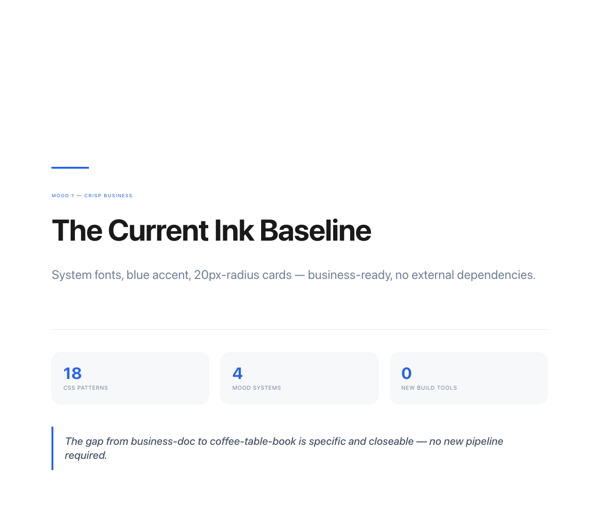
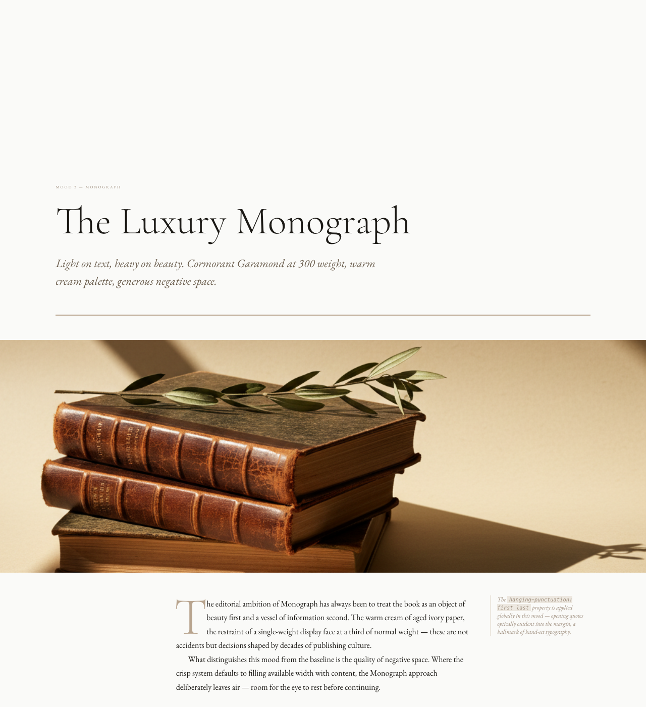
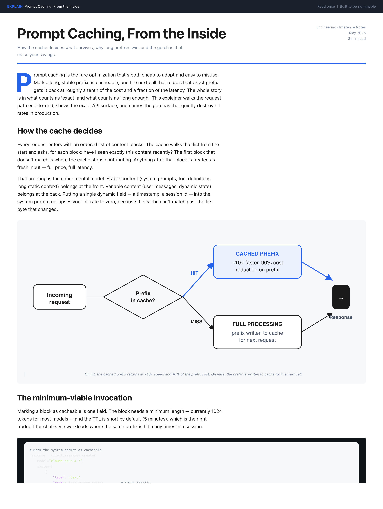

# Ink

Ink is a skill for creating composed, human-facing HTML artifacts when layout or interaction carries meaning.

The durable idea is not simply “HTML instead of markdown.” Modern AI products can already generate HTML. Ink supplies the missing taste layer:

- Intent routing across ten information patterns
- Ten visual moods: five core moods with full templates, five reference moods as token sets
- A shared design system with print-aware components
- Lightweight editors that copy structured results back into the conversation
- Explicit boundaries for when HTML would be unnecessary or harmful

## Examples

```text
“Compare these three vendors across cost, risk, implementation effort,
and reversibility. Make it easy to scan and decide.”

Ink → comparison matrix + recommendation
    → portable HTML artifact
```

```text
“Explain how prompt caching works. Include the request path, code,
tradeoffs, and the failure modes. Use the monograph mood.”

Ink → long-form explainer + SVG flow diagram + annotated code
    → portable HTML artifact
```

```text
“Build a small editor for sorting these tickets into Now, Next,
Later, and Cut. Copy the result as markdown.”

Ink → keyboard-accessible drag-and-drop editor + live preview
    → copy the result back into the conversation
```

## Where Ink earns its keep

Use Ink for:

- Explorations with several genuinely different approaches
- Comparisons where side-by-side structure reveals tradeoffs
- Research explainers with diagrams, code, and callouts
- Annotated code reviews and control-flow explanations
- Decision briefs and planning artifacts
- Long-form reports and HTML presentations
- Infographics and metric-driven narratives
- Single-purpose editors with a copy-back loop

Stay in chat or markdown for short answers, machine-read state, task files, changelogs, and routine text updates. Use a production site or software-building workflow for durable hosted applications.

## Information patterns

| Pattern | Best for | Structural base |
|---|---|---|
| Exploration | Several distinct directions | Exploration template |
| Comparison | Options across named dimensions | Planning template, adapted as a matrix |
| Explainer | Concepts, systems, and research | Explainer template |
| Code review | Annotated diffs and control flow | Explainer template + diff components |
| Editor | Manipulating one small data shape | Editor template |
| Planning | Context, options, recommendation | Planning template |
| Brief | Compact executive or decision artifact | Brief template |
| Report | Structured long-form work | Report template |
| Presentation | Explicitly requested HTML slides | Presentation template |
| Infographic | Metrics, sequence, and visual story | Infographic template |

The pattern controls structure. The mood controls typography, palette, and rhythm. Ink keeps those axes separate so a folio report remains a report rather than becoming a mood demo.

## Mood gallery

### Crisp



Quiet, system-native, and business-ready. Best for briefs, comparisons, and planning work.

### Monograph



Spacious, literary, and premium. Best for narrative explainers and portfolio-like reports.

### Folio


Dense and authoritative. Best for reference material and technical deep dives.

### Modernist


Architectural, restrained, and grid-led. Best for design and strategy artifacts.

### Arcade


Playful retro manual styling. Best for gaming, nostalgic, or deliberately informal work.

## Representative artifacts

### Exploration


Source: [`examples/type-exploration.html`](examples/type-exploration.html)

### Explainer



Source: [`examples/type-explainer.html`](examples/type-explainer.html)

### Editor


Source: [`examples/type-editor.html`](examples/type-editor.html)

### Planning


Source: [`examples/type-planning.html`](examples/type-planning.html)

## Image strategy

Ink supports three image strategies:

- `none` — typography, color, rules, and CSS-drawn forms; the default
- `placeholders` — inline SVG or CSS placeholders sized to the layout
- `host-native` — an image-generation capability already provided by the host, used only when requested or approved

The public skill does not request, read, store, or configure API keys and does not call paid third-party image APIs directly.

## Runtime contracts

1. Static artifacts have no JavaScript dependencies.
2. Editor artifacts may use dependency-free vanilla JavaScript for local controls and copy-back behavior.
3. The mood library is curated rather than open-ended.
4. HTML is the primary artifact; PDF is optional and downstream.
5. Generated files live in the host workspace’s user-facing output location, never inside the skill folder.
6. Ink never publishes, deploys, uploads, or changes sharing permissions without explicit authorization.

## Public plugin bundle

The submission-ready runtime is intentionally small:

```text
ink/
├── SKILL.md
├── agents/
│   └── openai.yaml
└── templates/
    ├── base-styles.css
    ├── exploration-template.html
    ├── explainer-template.html
    ├── editor-template.html
    ├── planning-template.html
    ├── brief-template.html
    ├── report-template.html
    ├── infographic-template.html
    ├── presentation-template.html
    ├── monograph-template.html
    ├── folio-template.html
    ├── modernist-template.html
    └── arcade-template.html
```

The source repository also keeps screenshots, full examples, and development utilities for maintainers; those files are not shipped in the runtime bundle.

## Installation

Ink is being prepared for OpenAI’s unified plugin directory. Until the public listing is approved, install it from the `hurleywgly/skills` repository using your agent’s supported skill-installation workflow.

Select it explicitly as `@ink` in ChatGPT or `$ink` in Codex, or describe a request that matches the skill’s purpose.

## Origin and inspiration

Ink was built around Thariq Shihipar’s argument that HTML can be a better working medium for agents once documents become too visual, structural, or interactive for markdown. It also draws on Zara Zhangrui’s `frontend-slides`, HyperFrames’ HTML-over-framework thesis for agent artifacts, and editorial print traditions spanning monographs, reference publishing, and modernist books.

Ink’s contribution is the design discipline and routing layer that turns those ideas into a reusable workflow.

## License

MIT
